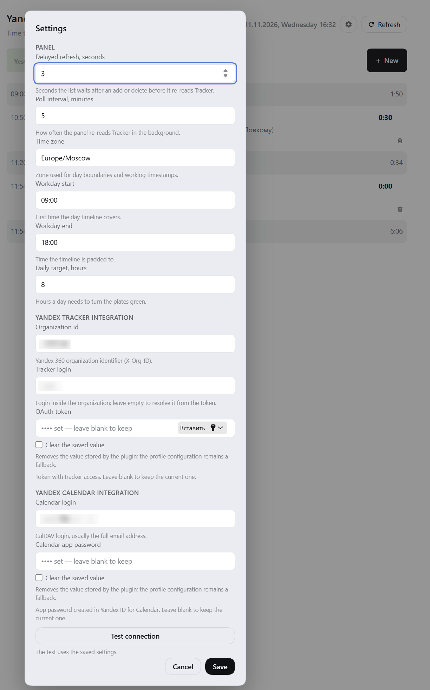

<p align="center">
  
</p>

<h1 align="center">dsh-yt-ttt</h1>

<p align="center"><b>Time Tracked Today</b> — the time logged in Yandex Tracker today, right in the DeepSeek Harness sidebar.</p>

The plugin shows how much time you have already logged today in the sidebar rail and, on click, opens a panel with today's and yesterday's totals, the worklog list, and a form for logging new time — without switching to the browser.

## How it works

It is not a separate app and there is no build step: two halves in plain JavaScript plus a configuration layer.

- **Host half** (`index.js`) runs inside the DeepSeek Harness process: it registers the plugin's authenticated Web routes, calls the Tracker API and Calendar CalDAV, and keeps the settings and the caches.
- **Browser half** (`client.js`) is a single module the page loads through `window.__ModuleLoader__`; it renders the badge and the panels with the React the interface already ships.
- **Bundle layer** (`cordis.patch.yml`) adds the plugin row to the profile; `locale/*.json` and `icon.svg` provide the localization and the icon.

Stack: plain JavaScript (ESM), no bundler, no transpilation, no dependencies — React, routing, storage and the credential store are provided by DSH itself. The whole repository is a handful of files you can read end to end.

## About tokens

The plugin never talks to a language model: it does not prompt an LLM and does not run the agent. Using it **spends no DeepSeek tokens** — not for the badge, not for the panel, not for logging time. The only outbound calls go to the Yandex Tracker API and, with a calendar connected, to Yandex Calendar CalDAV, and they leave the host process rather than the page.

## Features

- **Rail badge** — today's total; it turns green once the daily target is reached (8 hours by default).
- **Two-day panel** — totals and worklogs for today and yesterday, with the day timeline padded to the working interval (09:00–18:00), so the gaps are visible.
- **Logging time** — issue key with a picker over your open issues, date, calendar event, start, duration, end and comment. The duration mask reads `245` as `02:45`, and a closed issue refuses new time.
- **Deleting a record** — a trash icon in the row with a confirmation that says the removal cannot be undone.
- **Calendar** — the day's meetings over CalDAV of Yandex Calendar; a picked event fills in the time and the comment topic.
- **Pinned teamwork issue** — one issue for quick entries, stored in the profile.
- **Settings windows** — panel behavior, working day, zone, queue, poll interval, and the Tracker and Calendar connections.
- **Secrets live in the profile credential store**, not in YAML and not in the plugin's JSON record.

## Requirements

- DeepSeek Harness with the Web UI (tested on `0.2.2-rc.1`).
- A Yandex Tracker OAuth token with the `tracker:read` scope; `tracker:write` as well for adding and deleting records.
- An organization identifier: `orgId` (Yandex 360) **or** `cloudOrgId` (Yandex Cloud).
- For the meeting list (optional): a CalDAV login and a Yandex Calendar app password created in Yandex ID.

## Installation

The package is not on npm yet, so it is wired in as a local link.

1. Clone the repository anywhere:

```powershell
git clone https://github.com/olegpoz/dsh-yt-ttt.git C:\tools\dsh-yt-ttt
```

2. In your DSH profile directory (for the desktop build `%DSH_HOME%\profiles\<profile>`, for the CLI `~/.dsh/profiles/<profile>`), add the dependency and the bundle to `package.json`:

```json
{
  "dependencies": {
    "dsh-yt-ttt": "link:C:/tools/dsh-yt-ttt"
  },
  "dsh": {
    "profile": {
      "bundles": ["@deepseek-ai/dsh-base", "@deepseek-ai/dsh-web-app", "dsh-yt-ttt"]
    }
  }
}
```

3. Install and restart DSH. The badge appears in the rail.

```powershell
pnpm install
```

Once published to npm, installation becomes `pnpm add dsh-yt-ttt` plus one line in `dsh.profile.bundles`.

## Configuration

The main path is the **settings window**: the gear in the panel and the gear in the "Adding time" form. Values are saved in the profile and apply immediately, no restart needed. **Test connection** in the same window checks both connections against the saved values.



### Connecting Yandex Tracker

Three things are needed: the organization id, an OAuth token and, optionally, the login.

**1. Organization id.** Open **Administration → Organizations** ([tracker.yandex.ru/admin/orgs](https://tracker.yandex.ru/admin/orgs)) and copy the **identifier**. That is `orgId`, sent as `X-Org-ID`. A Yandex Cloud organization uses the cloud console id instead, as `cloudOrgId` with the `X-Cloud-Org-ID` header — fill exactly one of the two fields.

**2. OAuth token.** The plugin needs `tracker:read`; add `tracker:write` when the add and delete actions are used.

1. Open [oauth.yandex.ru](https://oauth.yandex.ru) and press **Create** on the *Your applications* page.
2. Choose **For API access or debugging**.
3. Give the app a name and a contact email.
4. Add the `tracker:read` scope, and `tracker:write` if you need writes.
5. Create the app and copy its **ClientID**.
6. Sign in as the account the plugin should act for and open:

```
https://oauth.yandex.ru/authorize?response_type=token&client_id=CLIENT_ID
```

7. Copy the token from the page and paste it into **OAuth token**.

The token is shown once and is never handed back to the browser: the plugin keeps it in the profile credential store.

**3. Tracker login may stay empty.** The plugin then asks `/myself` once and takes the login from the token. Fill it in only when the organization's login differs from what `/myself` reports. The login only affects the "my worklogs" filter; the author of a new record always comes from the token.

### Connecting Yandex Calendar (optional)

Without this step everything works, the add form just has no event list.

1. Open [id.yandex.ru/security](https://id.yandex.ru/security) → **Access to your data** → **App passwords**.
2. Under *Create an app password* choose **CalDAV client for Yandex Calendar**.
3. Name it (for example `dsh-yt-ttt`) and press **Next**.
4. Copy the password: it is shown only once.

Put it into **Calendar app password**, and use the full account address (`user@example.com`) in **Calendar login**.

> **Note:** Yandex activates a new app password after 2–3 hours, not immediately. An authorization error right after setup is expected.

### Other settings

Every value below is stored in the profile; no YAML editing is required.

| Setting | Default | What it does |
|---|---|---|
| Time zone | host zone | Decides the day boundaries and the timestamps |
| Workday start / end | `09:00` / `18:00` | The interval the day timeline is padded to |
| Daily target, hours | `8` | How much the day needs to turn the badge green |
| Default queue | — | The queue a digits-only key expands with (`426` → `QUEUE-426`) |
| Default duration, minutes | `60` | Length of a new record when the day has no matching gap |
| Maximum duration, hours | `8` | Upper bound the form accepts |
| When Duration changed | `end` | Which side moves when the duration changes: end (`Recalc End`) or start (`Recalc Start`) |
| Delayed refresh, seconds | `3` | Pause before re-reading the list after an add or delete |
| Poll interval, minutes | `5` | How often the panel re-reads Tracker in the background |
| Event comment prefix | `Встреча: ` | Text put before an event title in the comment |
| Organization id | — | `X-Org-ID` (or `X-Cloud-Org-ID`) |
| Tracker login | from the token | Login inside the organization; empty means resolved via `/myself` |
| OAuth token | — | The Tracker token; settings window only, never read from YAML |
| Calendar login | — | The CalDAV login, usually the full address |
| Calendar app password | — | The Calendar app password; settings window only |

Secret fields behave as "blank means keep": enter a value to replace it, use the clear row to remove it. Stored values are never handed back to the browser — the window only learns whether a value is set.

### YAML configuration

YAML carries non-secret values only: `orgId`, `login`, `timeZone`, `defaultQueue`, `workdayEnd`, `calendarLogin` and the `apiBase`, `webBase`, `calendarUrl` endpoints. A ready block is in [config.example.yml](config.example.yml).

Precedence: whatever the settings window stored overrides the config. The config acts as the first-run default and as a way to provision the plugin without clicking through the UI. Secrets are absent from that list on purpose — see below.

## Security

- The Tracker token and the Calendar app password are kept in the **profile credential store** under `yandex-tracker-today/tracker-token` and `yandex-tracker-today/calendar-password`.
- **The plugin config is not a secret source.** A `token` or `calendarPassword` written in `cordis.patch.yml` is ignored and a warning is logged. A config file is the thing that gets copied between machines and committed to a repository, so a secret does not belong there.
- The browser half only talks to the plugin's authenticated routes (`/yandex-tracker-today/*`) and never receives a secret; Tracker and Calendar are called from the host process.
- The plugin's JSON record keeps no secrets, only settings. Values written by older builds are moved into the store and dropped from the record.
- If the profile offers no credential store, the settings window refuses to save a secret and answers `unavailable` instead of writing it into the plugin record.
- `tracker:read` is enough on its own; `tracker:write` is needed only for adding and deleting.

## Troubleshooting

| Symptom | Cause |
|---|---|
| The rail shows "not configured" | No token or no organization identifier |
| `401` / `403` from Tracker | The token expired or lacks the scope |
| An issue refuses time | The issue is closed; the form checks this and refuses to save |
| "Calendar is not connected" | `calendarLogin` or the app password is missing |
| Calendar: an authorization error right after setup | A new app password takes 2–3 hours to activate |
| A token sits in YAML but the plugin ignores it | Config is not a secret source; enter the token in the settings window |
| Empty queue for a digits-only key | `defaultQueue` is not set |
| The time in the panel looks wrong | Check `Time zone`: the day boundaries follow it |

## Limitations

- Yandex Tracker and Yandex Calendar only; no other trackers.
- Nothing is cached on disk: when the API is unreachable the panel reports an error instead of the last known value.
- The add form accepts only today and yesterday.

## License

[MIT](LICENSE).

Unofficial plugin: not affiliated with Yandex and not part of DeepSeek Harness.
