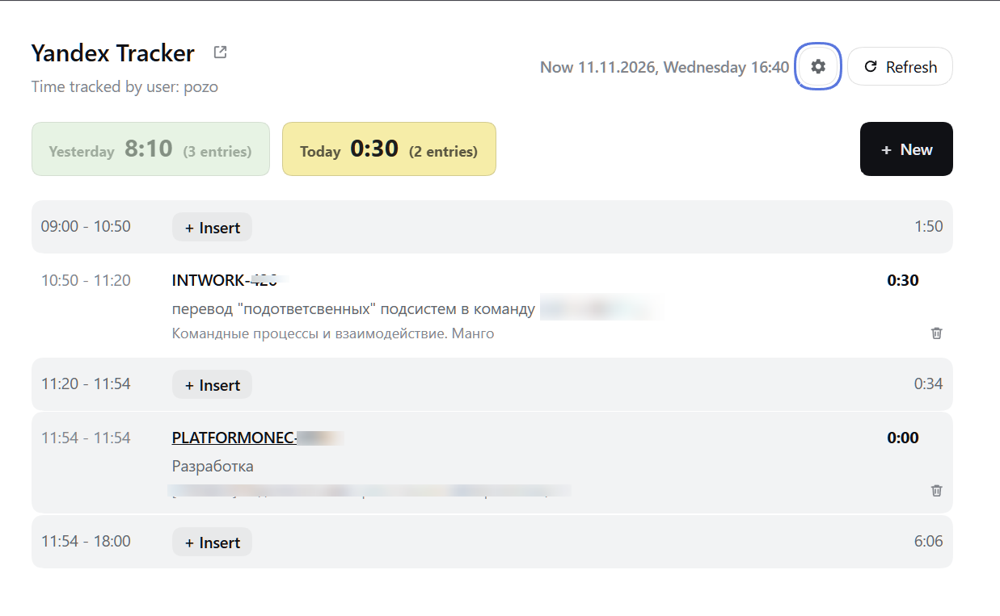
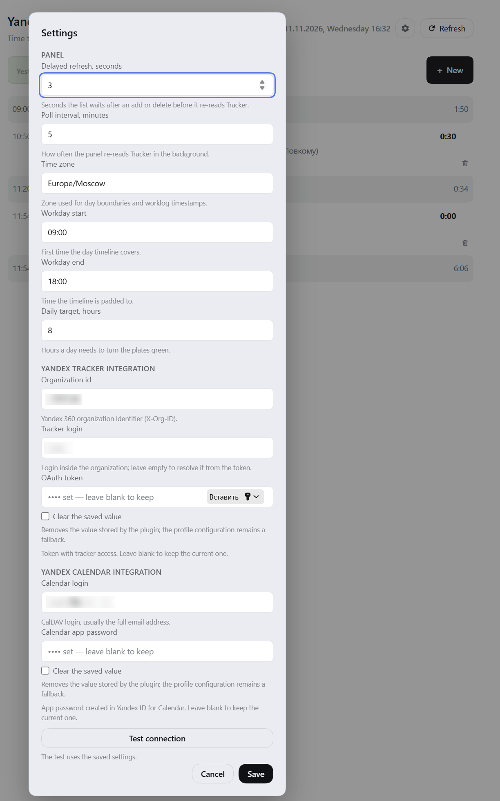

<p align="center">
  
</p>

<h1 align="center">dsh-yt-ttt</h1>

<p align="center"><b>Time Tracked Today</b> — списанное за сегодня время в Яндекс Трекере прямо в боковой панели DeepSeek Harness.</p>

Плагин показывает в рельсе сайдбара, сколько времени ты уже списал за сегодня, и по клику открывает панель с итогами за сегодня и вчера, списком записей и формой добавления нового списания — без переключения в браузер.

## Как устроено

Это не отдельное приложение и не сборка, а две половины на обычном JavaScript плюс слой конфигурации.

- **Хостовая половина** (`index.js`) работает в процессе DeepSeek Harness: регистрирует аутентифицированные Web-роуты плагина, ходит в API Трекера и в CalDAV Календаря, держит настройки и кеш.
- **Браузерная половина** (`client.js`) — один модуль, который страница подхватывает через `window.__ModuleLoader__`; он рисует бейдж и панели на React, который уже поставляет сам интерфейс.
- **Слой бандла** (`cordis.patch.yml`) добавляет строку плагина в профиль, `locale/*.json` и `icon.svg` дают локализацию и иконку.

Стек: чистый JavaScript (ESM), без сборщика, транспиляции и зависимостей — React, роутинг, хранилище и credential store предоставляет DSH. Поэтому весь репозиторий — несколько файлов, которые можно прочитать целиком.

## Про токены

Плагин не обращается к языковым моделям: он ничего не спрашивает у LLM и не запускает агента. Его использование **не расходует токены DeepSeek** — ни за бейдж, ни за панель, ни за добавление записи. Наружу уходят только запросы к API Яндекс Трекера и, если календарь подключён, к CalDAV Яндекс Календаря; делает их host-процесс, а не страница.

## Возможности

- **Бейдж в рельсе** — суммарное время за сегодня; кнопка зеленеет при достижении дневной цели (по умолчанию 8 часов).
- **Панель за два дня** — итоги и список записей за сегодня и за вчера, шкала дня дополнена до рабочего интервала (09:00–18:00), видно, где в дне есть «дыры».
- **Добавление записи** — ключ задачи с подсказкой из своих открытых задач, дата, событие календаря, начало, длительность, конец и комментарий. Маска длительности понимает `245` как `02:45`, статус закрытой задачи не даст списать время.
- **Удаление записи** — корзина в строке с подтверждением и напоминанием, что отменить нельзя.
- **Календарь** — список встреч на дату через CalDAV Яндекс.Календаря; выбранная встреча подставляет время и тему в комментарий.
- **Закреплённая задача** — одна «командная» задача для быстрых списаний, хранится в профиле.
- **Окна настроек** — поведение панели, рабочий день, зона, очередь, интервал опроса и подключение к Трекеру и Календарю.
- **Секреты — в хранилище учётных данных профиля**, а не в YAML и не в JSON плагина.

## Требования

- DeepSeek Harness с Web-интерфейсом (проверено на `0.2.2-rc.1`).
- OAuth-токен Яндекс Трекера со scope `tracker:read`; для добавления и удаления записей — ещё и `tracker:write`.
- Идентификатор организации: `orgId` (Яндекс 360) **или** `cloudOrgId` (Яндекс Облако).
- Для списка встреч (необязательно): логин CalDAV и пароль приложения Яндекс.Календаря, созданный в Яндекс ID.

## Установка

Пока пакет не опубликован в npm, подключение идёт локальной ссылкой.

1. Склонируй репозиторий в любое место:

```powershell
git clone https://github.com/olegpoz/dsh-yt-ttt.git C:\tools\dsh-yt-ttt
```

2. В каталоге своего профиля DSH (у desktop-сборки это `%DSH_HOME%\profiles\<профиль>`, у CLI — `~/.dsh/profiles/<профиль>`) добавь зависимость и бандл в `package.json`:

```json
{
  "dependencies": {
    "dsh-yt-ttt": "link:C:/tools/dsh-yt-ttt"
  },
  "dsh": {
    "profile": {
      "bundles": ["@deepseek-ai/dsh-base", "@deepseek-ai/dsh-web-app", "dsh-yt-ttt"]
    }
  }
}
```

3. Поставь зависимость и перезапусти DSH. В рельсе появится бейдж.

```powershell
pnpm install
```

После публикации в npm установка сводится к `pnpm add dsh-yt-ttt` и одной строке в `dsh.profile.bundles`.

## Настройка

Основной путь — **окно настроек**: шестерёнка в панели и шестерёнка в форме «Adding time». Значения сохраняются в профиле и применяются сразу, перезапуск не нужен. Кнопка **Test connection** в том же окне проверяет оба подключения по сохранённым значениям.



### Подключение к Яндекс Трекеру

Нужны три вещи: идентификатор организации, OAuth-токен и (необязательно) логин.

**1. Идентификатор организации.** Открой **Администрирование → Организации** ([tracker.yandex.ru/admin/orgs](https://tracker.yandex.ru/admin/orgs)) и скопируй значение поля **идентификатор**. Это `orgId`: плагин отправляет его в заголовке `X-Org-ID`.

Если твой Трекер работает в организации Yandex Cloud, идентификатор берётся из консоли облака и передаётся как `cloudOrgId` (заголовок `X-Cloud-Org-ID`). Заполнять нужно ровно одно из двух полей.

**2. OAuth-токен.** Плагину нужен токен с доступом `tracker:read`, а если пользуешься добавлением и удалением записей — ещё и `tracker:write`.

1. Открой [oauth.yandex.ru](https://oauth.yandex.ru) → на странице **Ваши приложения** нажми **Создать**.
2. Выбери **Для доступа к API или отладки** → **Перейти к созданию**.
3. Укажи название приложения и почту для связи.
4. В поле **Название доступа** добавь разрешения: `tracker:read` и, при необходимости, `tracker:write`.
5. Нажми **Создать приложение** и скопируй **ClientID** созданного приложения.
6. Войди в аккаунт, от имени которого будет работать плагин, и открой ссылку, подставив свой ClientID:

```
https://oauth.yandex.ru/authorize?response_type=token&client_id=ИДЕНТИФИКАТОР_ПРИЛОЖЕНИЯ
```

7. На странице появится токен — скопируй его и вставь в поле **OAuth token** в окне настроек.

Токен показывается один раз и больше нигде не отображается: плагин хранит его в credential store профиля, в браузер он не возвращается. Если токен потерян, получи новый по той же ссылке.

**3. Tracker login — можно оставить пустым.** Тогда плагин один раз запросит `/myself` и возьмёт логин из токена сам; это лишний запрос, но настраивать нечего. Заполнять стоит, если логин в организации отличается от того, что отдаёт `/myself` (например, вход по адресу почты). Логин влияет только на фильтр «мои записи» в панели: при добавлении автор записи всё равно определяется токеном, а не этим полем.

### Подключение к Яндекс Календарю (необязательно)

Без этого шага всё работает, просто в форме добавления не будет списка встреч.

1. Открой [id.yandex.ru/security](https://id.yandex.ru/security) → раздел **Доступ к вашим данным** → **Пароли приложений**.
2. В блоке **Создать пароль приложения** выбери тип **CalDAV-клиент для Яндекс Календаря**.
3. Придумай название (например, `dsh-yt-ttt`) и нажми **Далее**.
4. Скопируй показанный пароль: он отображается один раз.

Пароль вставь в поле **Calendar app password**, а в **Calendar login** укажи полный адрес аккаунта — `user@example.com`, не короткий логин.

> **Важно:** Яндекс включает новый пароль приложения не мгновенно, а через 2–3 часа. Если календарь сразу после настройки отвечает ошибкой авторизации — это ожидаемо, подожди и нажми **Test connection** ещё раз.

### Общие настройки

Все значения ниже хранятся в профиле и не требуют правки YAML.

| Настройка | По умолчанию | Что делает |
|---|---|---|
| Time zone | зона хоста | Определяет границы дня и метки времени |
| Workday start / end | `09:00` / `18:00` | Интервал, до которого дополняется шкала дня |
| Daily target, hours | `8` | Сколько часов нужно, чтобы бейдж позеленел |
| Default queue | — | Очередь, в которую разворачивается числовой ключ (`426` → `QUEUE-426`) |
| Default duration, minutes | `60` | Длительность новой записи, если в дне нет подходящей «дыры» |
| Maximum duration, hours | `8` | Верхняя граница длительности в форме |
| When Duration changed | `end` | Что сдвигается при правке длительности: конец (`Recalc End`) или начало (`Recalc Start`) |
| Delayed refresh, seconds | `3` | Пауза перед перечитыванием списка после добавления или удаления |
| Poll interval, minutes | `5` | Как часто панель сама перечитывает Трекер |
| Event comment prefix | `Встреча: ` | Что подставляется перед темой встречи в комментарии |
| Organization id | — | `X-Org-ID` (или `X-Cloud-Org-ID`) |
| Tracker login | из токена | Логин в организации; пусто — определится через `/myself` |
| OAuth token | — | Токен Трекера; только через окно настроек, из YAML не читается |
| Calendar login | — | Логин CalDAV, обычно полный адрес |
| Calendar app password | — | Пароль приложения Календаря; только через окно настроек |

Поля-секреты ведут себя как «пусто = оставить как есть»: чтобы заменить значение, введи новое, чтобы удалить — используй строку очистки. Сохранённые значения никогда не отдаются обратно в браузер: окно видит только «задан / не задан».

### Конфигурация через YAML

В YAML можно задать только не-секретные значения: `orgId`, `login`, `timeZone`, `defaultQueue`, `workdayEnd`, `calendarLogin` и эндпоинты `apiBase`, `webBase`, `calendarUrl`. Готовый блок — в [config.example.yml](config.example.yml).

Приоритет: сохранённое в окне настроек перекрывает конфиг. Конфиг работает как значение по умолчанию при первом запуске и как способ развернуть плагин без кликов. Секретов в этом списке нет намеренно — подробности ниже.

## Безопасность

- Токен Трекера и пароль приложения Календаря хранятся в **credential store профиля** под ключами `yandex-tracker-today/tracker-token` и `yandex-tracker-today/calendar-password`.
- **Конфигурация плагина не является источником секретов.** Если `token` или `calendarPassword` записаны в `cordis.patch.yml`, они игнорируются, а в лог уходит предупреждение. Причина простая: конфиг — это файл, который копируют между машинами и коммитят в репозиторий, а секрету там не место.
- Браузерная половина плагина общается только с аутентифицированными роутами плагина (`/yandex-tracker-today/*`) и никогда не получает секрет; запросы к Трекеру и Календарю идут из host-процесса.
- В JSON-записи плагина секретов нет: хранятся только настройки. Значения, сохранённые старыми сборками, переносятся в хранилище и вычищаются из записи.
- Если профиль не предоставляет хранилище учётных данных, окно настроек не станет молча писать секрет в JSON — оно вернёт ошибку `unavailable`.
- Токену достаточно `tracker:read`; `tracker:write` нужен только если пользуешься добавлением и удалением.

## Решение проблем

| Симптом | Причина |
|---|---|
| В рельсе «not configured» | Не заданы токен или идентификатор организации |
| Токен прописан в YAML, но плагин его не видит | Секреты из конфига игнорируются; задай токен в окне настроек |
| `401` / `403` от Трекера | Токен истёк или у него нет нужного scope |
| Задача не принимает время | Задача закрыта — форма это проверяет и не даст сохранить |
| «Календарь не подключён» | Не заданы `calendarLogin` и пароль приложения |
| Календарь: ошибка авторизации сразу после настройки | Новый пароль приложения начинает действовать через 2–3 часа |
| Пустая очередь при числовом ключе | Не задан `defaultQueue` |
| Время в панели не то | Проверь `Time zone`: от него зависят границы дня |

## Ограничения

- Только Яндекс Трекер и Яндекс Календарь; другие трекеры не поддерживаются.
- Данные не кешируются на диск: при недоступном API панель покажет ошибку, а не последнее известное значение.
- Форма добавления принимает только текущую и предыдущую дату.

## Лицензия

[MIT](LICENSE).

Плагин неофициальный: не связан с Яндексом и не является частью DeepSeek Harness.
